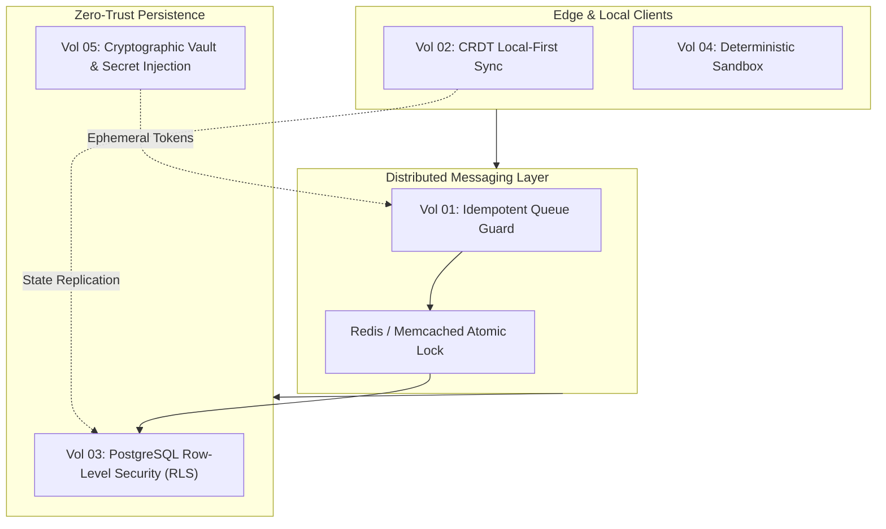

# Software Engineering Handbook & Architecture Whitepapers

[](https://github.com/FelipeMadson/software-engineering-handbook/actions)
[](https://opensource.org/licenses/MIT)
[](ebooks/metadata.json)
[](README.pt-BR.md)

An exhaustive, peer-grade repository of software engineering handbooks, distributed systems architecture whitepapers, and local-first systems design manuals authored by **Felipe Madson** with local deterministic AI assistance.

[Versão em Português](README.pt-BR.md) · [Portfolio](https://felipemadson.github.io/portfolio/) · [GitHub Profile](https://github.com/FelipeMadson)

---

## Volume Overview & Cryptographic Ledger

Every book in this collection is backed by an immutable cryptographic SHA-256 checksum and exact word count recorded in [`ebooks/metadata.json`](ebooks/metadata.json).

| Vol | Title | Focus Area | Reading Time | Verified SHA-256 | Format |
|---|---|---|---|---|---|
| **01** | [Guarding Distributed Asynchronous Queues with Idempotency](ebooks/idempotent-queue-guard/ebook.md) | Distributed Systems, Resilient Messaging | 48 min | `89ae65ad...` | Markdown & Diagrams |
| **02** | [Local-First Collaborative Systems with Conflict-Free Replicated Data Types (CRDT)](ebooks/crdt-offline-first/ebook.md) | Peer-to-Peer, Offline Sync, State Merging | 48 min | `3f2f8115...` | Markdown & Math |
| **03** | [Enterprise Multi-Tenant Data Isolation with PostgreSQL Row-Level Security (RLS)](ebooks/multitenant-security-rls/ebook.md) | Database Security, Cloud Tenancy | 48 min | `38b4887b...` | Markdown & SQL |
| **04** | [Deterministic Development Environments and Reproducible Sandboxes](ebooks/deterministic-dev-environments/ebook.md) | DevEx, Sandbox Isolation, Supply-Chain | 48 min | `9cf9fb0c...` | Markdown & Specs |
| **05** | [Arquitetura de Segredos, Sandboxing e Isolamento Criptográfico em CI/CD](ebooks/arquitetura-de-segredos-e-isolamento-em-ci/ebook.md) | AppSec, Ephemeral Containers, Zero-Trust | 48 min | `0e380f33...` | Markdown & Security |

---

## Architectural Highlights



### 1. Guarding Distributed Queues
- **Two-phase state deduplication** with atomicity guarantees.
- Poison message quarantine without data loss.
- High-throughput idempotency under network partitions ($CAP$ Theorem constraints).

### 2. Local-First Collaborative CRDTs
- State-based ($CvRDT$) and Operation-based ($CmRDT$) state convergence.
- Lamport timestamps and Vector clocks for causal ordering without central lock contention.
- Delta-state replication reducing bandwidth by up to 90% in peer meshes.

### 3. Multi-Tenant PostgreSQL RLS
- Enforcing hardware-isolated data security within a unified relational cluster.
- Session-scoped `SET LOCAL app.current_tenant_id` invariants.
- Defense-in-depth against SQL injection bypassing multi-tenancy.

### 4. Deterministic Sandboxes
- Cryptographically reproducible execution environments.
- Lockfile pinning, networkless compilation, and container hermeticism.
- Elimination of *"works on my machine"* syndrome across developer teams.

### 5. Cryptographic CI/CD Isolation
- Ephemeral worker sandboxes with `ALL` capabilities dropped.
- Kernel-level privilege isolation (`no-new-privileges`).
- Zero-token exposure architecture in build logs and execution environments.

---

## Verification & Integrity

To verify the integrity of all volumes locally:

```bash
# Verify cryptographic hashes using Node.js or OpenSSL
node -e "
  const fs = require('fs'), crypto = require('crypto');
  const meta = JSON.parse(fs.readFileSync('ebooks/metadata.json', 'utf8'));
  for (const b of meta.ebooks) {
    const content = fs.readFileSync('ebooks/' + b.slug + '/ebook.md');
    const hash = crypto.createHash('sha256').update(content).digest('hex');
    console.log(b.slug, hash === b.sha256 ? 'VALID' : 'FAILED');
  }
"
```

---

## Author & Credits

- **Author**: Felipe Madson ([@FelipeMadson](https://github.com/FelipeMadson))
- **Methodology**: Local-First Engineering, Deterministic CI, Evidence-Based Research
- **License**: MIT License
