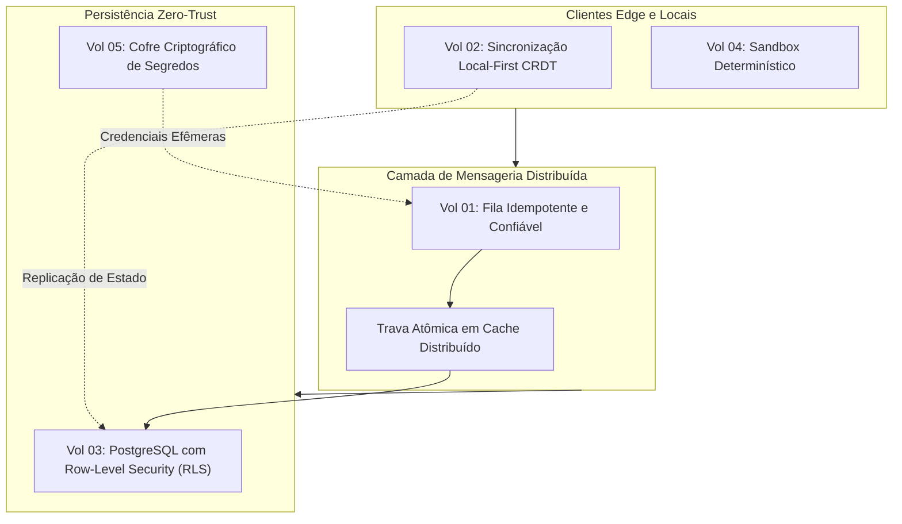

# Manual de Engenharia de Software & Artigos de Arquitetura

[](https://github.com/FelipeMadson/software-engineering-handbook/actions)
[](https://opensource.org/licenses/MIT)
[](ebooks/metadata.json)
[](README.md)

Repositório detalhado de manuais de engenharia de software, whitepapers de arquitetura de sistemas distribuídos e guias de design de sistemas *local-first*, de autoria de **Felipe Madson** com suporte de inteligência artificial determinística local.

[English Version](README.md) · [Portfólio](https://felipemadson.github.io/portfolio/) · [Perfil no GitHub](https://github.com/FelipeMadson)

---

## Sumário dos Volumes & Registro Criptográfico

Cada livro técnico desta coleção possui um hash SHA-256 imutável e contagem estrita de palavras registradas em [`ebooks/metadata.json`](ebooks/metadata.json).

| Vol | Título | Área Central | Tempo de Leitura | SHA-256 Verificado | Formato |
|---|---|---|---|---|---|
| **01** | [Proteção e Idempotência em Filas Assíncronas Distribuídas](ebooks/idempotent-queue-guard/ebook.md) | Sistemas Distribuídos, Mensageria Resiliente | 48 min | `89ae65ad...` | Markdown & Diagramas |
| **02** | [Sistemas Colaborativos Local-First com CRDT](ebooks/crdt-offline-first/ebook.md) | Peer-to-Peer, Sync Offline, Convergência | 48 min | `3f2f8115...` | Markdown & KaTeX |
| **03** | [Isolamento Multi-Tenant com PostgreSQL Row-Level Security (RLS)](ebooks/multitenant-security-rls/ebook.md) | Segurança em Bancos de Dados, Nuvem | 48 min | `38b4887b...` | Markdown & SQL |
| **04** | [Ambientes de Desenvolvimento Determinísticos e Sandboxes](ebooks/deterministic-dev-environments/ebook.md) | DevEx, Sandboxing, Reprodutibilidade | 48 min | `9cf9fb0c...` | Markdown & Specs |
| **05** | [Arquitetura de Segredos, Sandboxing e Isolamento em CI/CD](ebooks/arquitetura-de-segredos-e-isolamento-em-ci/ebook.md) | AppSec, Contêineres Efêmeros, Zero-Trust | 48 min | `0e380f33...` | Markdown & Segurança |

---

## Destaques da Arquitetura



---

## Verificação e Integridade

Para verificar a integridade de todos os volumes localmente:

```bash
node -e "
  const fs = require('fs'), crypto = require('crypto');
  const meta = JSON.parse(fs.readFileSync('ebooks/metadata.json', 'utf8'));
  for (const b of meta.ebooks) {
    const content = fs.readFileSync('ebooks/' + b.slug + '/ebook.md');
    const hash = crypto.createHash('sha256').update(content).digest('hex');
    console.log(b.slug, hash === b.sha256 ? 'VÁLIDO' : 'FALHOU');
  }
"
```

---

## Autor & Créditos

- **Autor**: Felipe Madson ([@FelipeMadson](https://github.com/FelipeMadson))
- **Metodologia**: Engenharia Local-First, CI Determinístico, Pesquisa Baseada em Evidências
- **Licença**: Licença MIT
