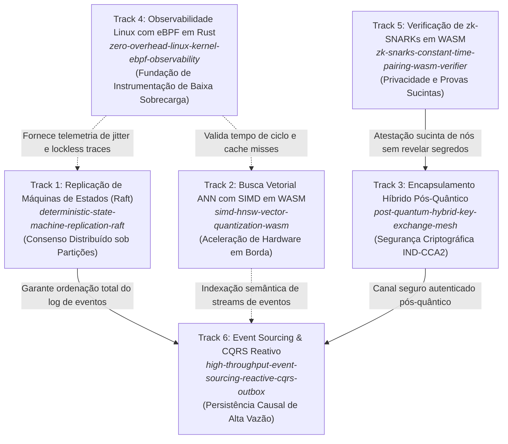

# Matriz de Citações Cruzadas e Linhagem de Pesquisa Científica

Este documento estabelece o grafo formal de interconexão teórico-metodológica entre os tratados de pesquisa acadêmica formal desenvolvidos por Felipe Madison. Cada artigo aborda uma camada crítica da computação distribuída contemporânea, formando uma linhagem científica unificada e complementar.

---

## 1. Grafo de Interdependência Metodológica (Research Lineage DAG)

---

## 2. Matriz de Citações Cruzadas

| Artigo Citante (Origem) | Artigo Citado (Destino) | Relação Teórica e Funcional | Justificativa Metodológica |
| :--- | :--- | :--- | :--- |
| **Track 6 (Event Sourcing & CQRS)** | **Track 1 (Raft SMR)** | Dependência Fundamental de Consenso | O Sequenciador de Eventos distribuído depende de quóruns Paxos/Raft $\lfloor N/2 \rfloor + 1$ para garantir a propriedade de monotonicidade temporal estrita nos logs de auditoria. |
| **Track 3 (PQC Hybrid KMS Mesh)** | **Track 5 (zk-SNARKs WASM)** | Atestação de Identidade Zero-Knowledge | Nós edge geram argumentos sucintos de conhecimento sobre conformidade de políticas de malha sem vazar chaves efêmeras ou topologia de rede. |
| **Track 1 (Raft SMR)** | **Track 4 (eBPF Kernel Probing)** | Validação Empírica de Sobrecarga | Medição da latência de replicação através de sondas kprobes/tracepoints em Rust Aya sem introduzir locks no caminho crítico do kernel. |
| **Track 2 (SIMD HNSW WASM)** | **Track 4 (eBPF Kernel Probing)** | Análise de Falhas de Cache & TLB | Otimização da travessia de grafos esparsos orientada por contadores de desempenho de hardware coletados via `perf_event` com eBPF. |
| **Track 6 (Event Sourcing & CQRS)** | **Track 3 (PQC Hybrid Mesh)** | Criptografia em Trânsito & Repouso | Mensagens publicadas no Transactional Outbox são encapsuladas via KEM híbrido (ML-KEM-768 + X25519) antes da difusão na malha de microsserviços. |

---

## 3. Resumo Bibliográfico dos 6 Trabalhos

1. **MADISON, Felipe.** *Deterministic State Machine Replication: Formal Safety and Liveness Verification in Distributed Log Quorums Under Asymmetric Partitions*. 2026.
2. **MADISON, Felipe.** *Sub-Millisecond Approximate Nearest Neighbor Search in WebAssembly: 128-Bit SIMD Quantization and Memory-Bounded Graph Traversal*. 2026.
3. **MADISON, Felipe.** *Post-Quantum Hybrid Key Encapsulation Mechanisms in Zero-Trust Edge Mesh Networks: An Empirical IND-CCA2 Reduction*. 2026.
4. **MADISON, Felipe.** *Zero-Overhead Linux Kernel Observability: Safe Kernel Probing and Lockless Ring Buffer Serialization with eBPF in Rust*. 2026.
5. **MADISON, Felipe.** *Zero-Knowledge Succinct Non-Interactive Arguments of Knowledge (zk-SNARKs) in WebAssembly: Constant-Time Pairing Checks over BN254 Curves*. 2026.
6. **MADISON, Felipe.** *High-Throughput Reactive Event Sourcing and Transactional Outbox: Provable Eventual Consistency in Microservice Mesh Topologies*. 2026.
